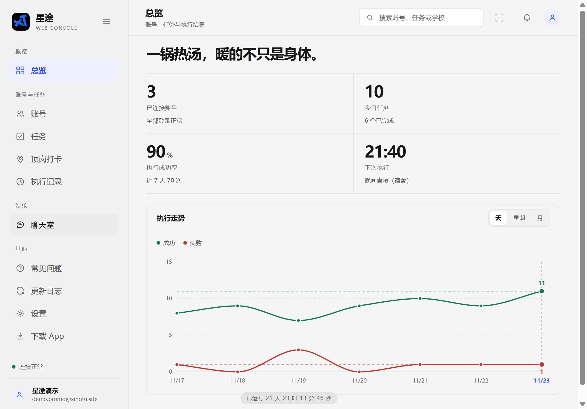
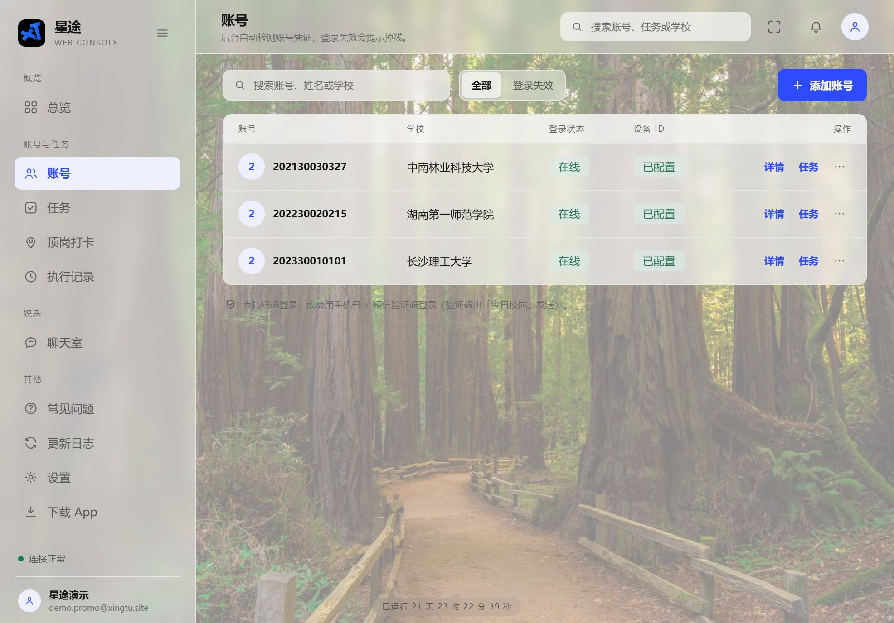
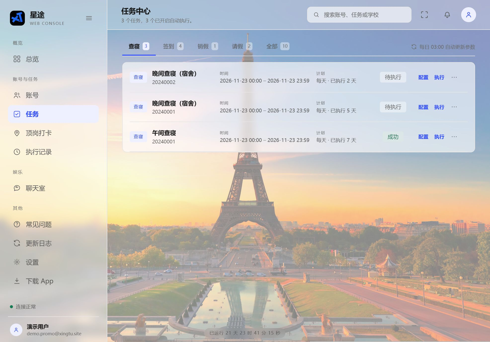
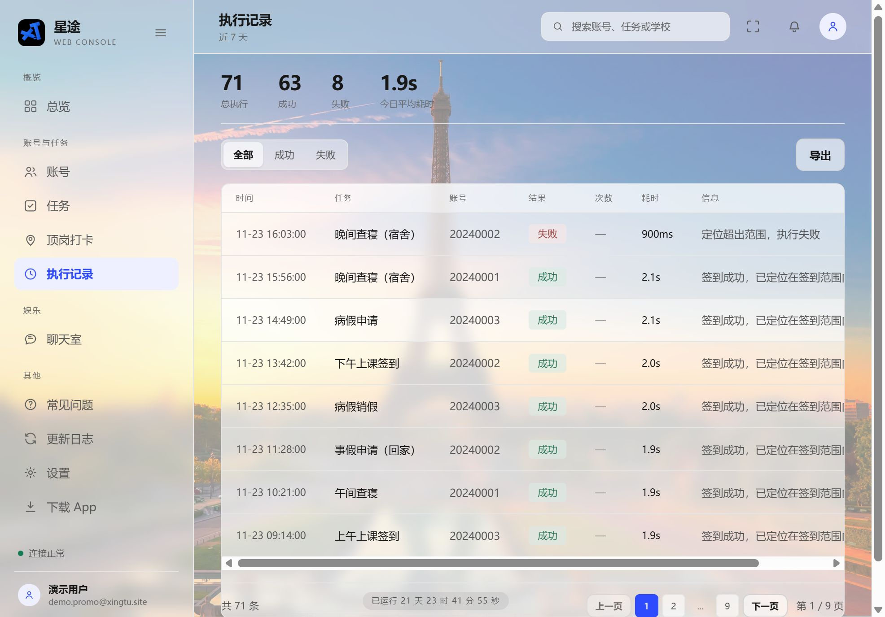
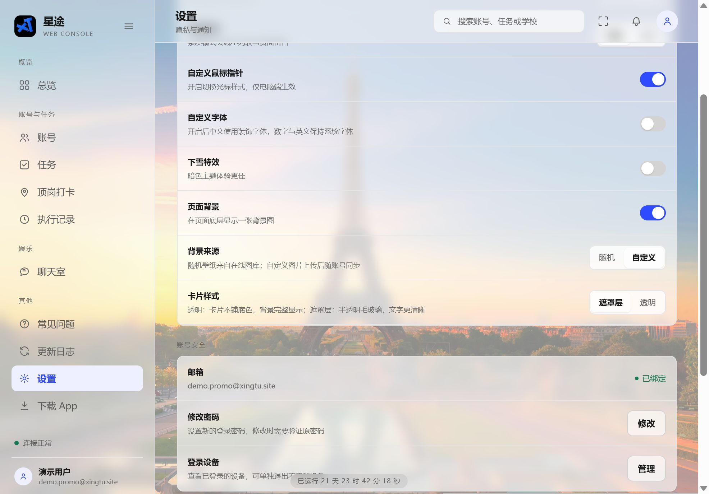
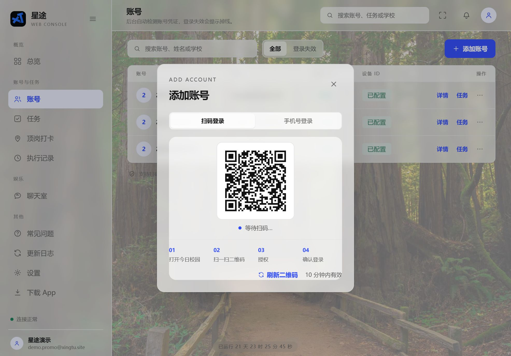
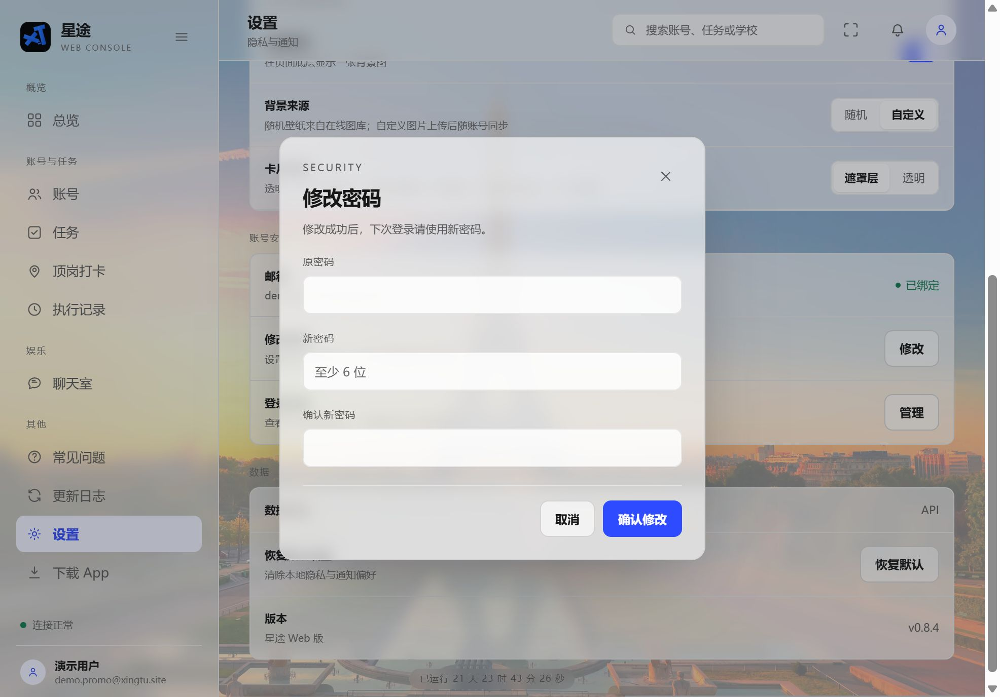

# 星途 · 校园任务自动化 Web 端

> 一站式管理多个校园账号，自动完成查寝、签到与请假销假。

**在线体验：** <https://www.qqjrxyk.cn>

> 上图：总览页，展示已连接账号、今日任务、执行成功率与近 7 天执行走势（演示数据）。

---

## 界面预览

### 账号管理

> 多账号集中管理，自动检测登录状态与设备 ID，支持扫码或手机号添加。

### 任务中心

> 查寝 / 签到 / 请假 / 销假分类管理，每天 03:00 自动更新任务参数。

### 执行记录

> 每次执行都会记录结果、耗时与失败原因，可按结果筛选并一键导出 TXT。

### 页面背景与毛玻璃

开启「设置 → 页面背景」后，卡片自动切换为半透明毛玻璃；背景可选在线随机壁纸，也可上传自定义图片，并随账号同步到其他设备。

> 背景来源、卡片样式（遮罩层 / 透明）与壁纸切换方式均可自定义。

> 弹窗统一使用毛玻璃效果，扫码登录四步完成授权。

> 账号安全相关弹窗同样保持背景通透，输入内容清晰可读。

---

## 这是什么

星途是一个面向在校学生的校园任务自动化 Web 工具。它把「今日校园」里每天重复的查寝、签到、请假、销假等操作集中到一个网页里：一次配置，之后自动执行，结果随时可查。支持桌面浏览器与手机浏览器，无需安装客户端即可使用。

## 核心功能

- **多账号统一管理**
  扫码登录或手机号 + 短信验证码登录，集中管理多个校园账号；自动检测登录状态，失效账号会及时标记。

- **定时自动执行**
  查寝、签到任务支持按计划自动运行，可自定义执行时间；任务列表实时显示当日执行结果。

- **请假与销假**
  同时兼容新版 / 旧版请假流程，支持审批人选择、影响课程查询、抄送人搜索；销假自动带出确认人，减少反复填写。

- **执行记录与导出**
  每次执行都记录结果、耗时与失败原因，可按结果、日期筛选，并一键导出 TXT 便于留存。

- **定岗打卡**
  针对实习 / 顶岗场景的打卡任务配置，支持位置选择与浏览器定位。

- **设备与账号安全**
  设备 ID 授权、手动填写、随机生成三种方式；支持查看并管理登录设备、远程下线。

- **个性化界面**
  深色模式、页面背景（在线随机壁纸 / 自定义图片）、侧边导航自定义、桌面与移动端自适应布局。

## 快速开始

1. 打开 <https://www.qqjrxyk.cn>，注册并登录；
2. 添加校园账号（扫码或手机号验证码）；
3. 为账号配置设备 ID，创建查寝 / 签到任务并设置执行时间；
4. 在「总览」查看账号状态、今日任务与执行成功率，在「执行记录」查看明细。

## 常见问题

**需要安装 App 吗？**
不需要，浏览器打开即可使用；手机浏览器同样适配。

**支持多少个账号？**
同一账号下可添加多个校园账号，统一管理。

**任务失败了怎么办？**
「执行记录」会给出失败原因；若提示账号失效，重新扫码更新凭证即可。

**我的账号信息如何保存？**
仅在你的账号下保存校园接口所需的授权凭据，用于代替你完成已配置的任务。

## 更新日志

- **0.8.4** 移动端账号 / 定岗打卡 / 执行记录列表卡片化，侧边栏宽度与间距优化
- **0.8.3** 执行记录 TXT 导出、侧边导航自定义、移动端一屏侧栏
- 更早版本可在站内「更新日志」查看

## 免责声明

本项目为个人学习与效率工具，与任何学校官方无关，也未获得任何学校的授权或认可。请在使用前确认符合所在学校的规定；因使用本项目产生的一切后果由使用者自行承担。

---

官网：<https://www.qqjrxyk.cn>
